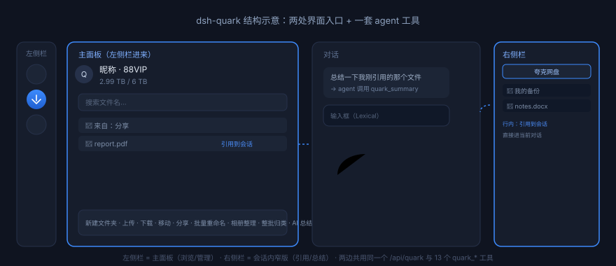

# dsh-quark

把 [夸克网盘](https://pan.quark.cn) 接进 [DeepSeek Harness](https://github.com/deepseek-ai) 的插件：左侧栏有主面板，会话右侧栏有标签页，agent 也能直接读写网盘。

它不自带网盘 SDK，而是包装夸克官方的 [`quarkclouddrive`](https://b.quark.cn/apps/quarkcloud_skill_info/routes/V-sc7gOBT) Skill 的 CLI —— 授权、接口签名、限流都交给官方工具，插件只负责把它变成"能点的界面"和"agent 能调的工具"。



## 插件简介

装上之后多出三样东西：

| 位置 | 是什么 |
| --- | --- |
| **左侧栏 → 夸克网盘** | 主面板：账号和容量、逐级浏览目录、搜索、底栏 9 个操作（新建文件夹、上传、下载、移动、分享、批量重命名、相册整理、整批归类、AI 总结） |
| **会话右侧栏 → 夸克网盘** | 同一个面板的窄版，聊天时随手翻网盘、把文件引用进对话 |
| **agent 工具 `quark_*`** | 14 个工具，让模型自己查环境、列目录、搜文件、下载、整理 |

两个入口各有一个显示开关（插件详情页里），关掉左侧栏会真的把入口摘掉，不是只隐藏。

## 使用要求

- **DeepSeek Harness**（Web / desktop 均可；要有右侧栏的版本才能用会话侧边那个标签页，老版本只有左侧主面板可用）
- **Node.js ≥ 18**
- **官方夸克网盘 Skill**（插件不复制也不修改它，只调用它的 `scripts/quark-drive.cjs`）
- **夸克账号**：文件浏览、上下传、移动、分享、重命名**不限会员等级**，普通账号可用；`AI 总结` / `智能搜索` / `相册整理` 这几项走的是夸克自己的 AI 能力，**需要 SVIP+ 会员**，非会员调用时官方 CLI 会返回会员提示

### 官方 Skill 需要单独装 —— 但只装一次

插件**不会**替你装它，因为那是夸克的官方发行包（含授权流程），不是本仓库的东西。装好之后，本插件会自动找到并一直复用；**以后升级/重装本插件都不用再装 Skill**。

**装法（任选其一）**

1. 在对话里说「请安装 夸克网盘 Skill，并授权账号」，agent 会按官方指引装好并引导授权。
2. 手动跑官方包里的安装脚本：

```bash
bash <skill-dir>/scripts/install.sh
```

装好后应该存在这个文件：

```
<DSH_HOME>/skills/quarkclouddrive/scripts/quark-drive.cjs
```

验证：

```bash
node <DSH_HOME>/skills/quarkclouddrive/scripts/quark-drive.cjs get-user-info
```

能打印昵称和容量就成了。

**已经装过了会怎样？** 插件只做只读探测（`fs.statSync` 看文件在不在），不会覆盖、不会改动、也不会重装 Skill。重复安装本插件是安全的。

**装在别的位置？** 用环境变量指过去：

- `DSH_QUARK_SKILL_DIR` —— 指向 skill 目录本身（它下面应有 `scripts/quark-drive.cjs`）
- `DSH_QUARK_CLI` —— 直接指向 `quark-drive.cjs`

**怎么确认当前状态？** 让 agent 调 `quark_check_env`，或看面板顶部的提示。它会告诉你：Skill 装没装、版本号、CLI 在哪、账号授权没授权。

## 安装插件

把仓库克隆下来，然后在 DSH 里让 agent 安装这个目录：

```js
plugin_manager({ action: 'install_bundle', target: '<这个仓库的绝对路径>' })
```

装完重启 DSH（或让 agent 把插件 disable → enable 一次）。左侧栏出现云朵图标就是成功了。

**卸载**：`plugin_manager({ action: 'remove_bundle', target: 'dsh-quark' })`。卸载本插件不影响官方 Skill，也不会撤销夸克授权。

## 使用方法

### 浏览和搜索

点左侧栏图标进主面板，网盘根目录的文件会直接列出来。

- **进文件夹**：点文件夹名
- **回上一级**：顶部有一排路径（`我的网盘 / 资料 / 2026`），点其中任意一级就跳回去
- **搜索**：顶部搜索框按文件名搜。搜出来的结果在「搜索结果」页签里，切回「文件」页签就回到当前目录

### 引用到会话

每个文件行右边有 `引用到会话` 和 `复制名称`。`引用到会话` 的行为看你在哪个入口点：

| 入口 | 行为 |
| --- | --- |
| **右侧栏** | 直接写进当前对话框（AI 总结还会顺手发送） |
| **主面板** | 先弹一个框让你选「放到当前会话」还是「开一个新会话」，选完自动跳过去 |

### AI 总结

点「AI 总结」，插件**不会**自己去调夸克助手，而是把你的选择写成一段请求，交给对话里的 agent：

- 选中若干文件 → 逐行列名字、大小、类型和 `fid`
- 什么都不选 → 以当前文件夹为范围（等于"文件夹总结"），让 agent 先看目录里有什么再总结

**这样做的原因**：夸克助手自己的接口经常返回 `-1501`（上游临时异常）或 `-1507`（5 分钟轮询超时，实测单篇 PDF 也可能超时），在面板里干等一个弹层体验很差。改成交给 agent 之后，agent 可以自己决定是调 `quark_summary`、还是换个方式读文件，也能跟你来回讨论。

**关于会员**：点这个按钮本身不消耗任何会员权益，它只是往对话框里写字。真正调用夸克 AI 助手（`quark_summary` / `quark_qa` 工具）时才需要 SVIP+；非会员会拿到夸克返回的会员提示，那时 agent 会告诉你，可以改用其他方式（比如先下载再看）。

### 移动

点「移动」会打开目录选择器，从根目录开始浏览，可以逐级进子目录、点路径回退，底部按钮写着你当前选中的目标（`移到「资料」`）。目标恰好是文件现在所在的目录时不会发请求，而是提示换一个。

### 其他底栏操作

- **上传**：填本机绝对路径，一行一个
- **下载**：默认落到系统「下载」文件夹（Windows 读注册表 Known Folder，macOS `~/Downloads`，Linux `$XDG_DOWNLOAD_DIR`）
- **分享**：默认建私密链接（带提取码），有效期永久
- **批量重命名**：一行一个「原文件名 → 新文件名」，走官方 `rename`，30 天内可用原 batch ID 撤销
- **相册整理**：一句话描述（如「把去年在青岛拍的照片按地点整理」），默认复制；超过 500 个文件会要你二次确认复制还是移动。**需要 SVIP+**
- **整批归类**：四步走 `init → check → apply → undo`，任务目录默认放在 `~/Documents/夸克整理记录`，撤回窗口 30 天

### 让 agent 用

装好之后直接说人话就行：

> 看看我夸克网盘根目录有什么
> 把网盘里的「项目书.zip」下载下来
> 总结一下网盘里的 JCIS 那篇 PDF
> 把搜索结果里这几个文件批量重命名成 2026-01 开头的

agent 会自己选工具。14 个工具见下表。

## agent 工具

| 工具 | 用途 |
| --- | --- |
| `quark_check_env` | 自检：Skill 装没装、版本、CLI 路径、账号授权状态 |
| `quark_get_user_info` | 昵称、会员类型、容量、到期时间 |
| `quark_list_files` | 列目录直接子项（`parent_fid="0"` 为根） |
| `quark_search` | 关键词搜索（找文件夹传 `search_type="dir"`） |
| `quark_create_folder` | 新建文件夹 |
| `quark_upload` | 上传本机文件/文件夹 |
| `quark_download` | 下载到本机（默认系统下载文件夹） |
| `quark_move` | 移动文件/文件夹 |
| `quark_share` | 创建分享链接（`url_type=2` 私密链接带提取码） |
| `quark_rename` | 批量重命名（1~5000 条/批），`revert` 撤销 |
| `quark_organize_album` | 相册整理（按人脸/地点/场景归类媒体，SVIP+） |
| `quark_organize_files` | 整批归类四步：init / check / apply / undo |
| `quark_summary` / `quark_qa` | 夸克 AI 助手总结 / 问答（`fid_list` ≤100，SVIP+） |
| `quark_login` | 登录授权 |

## 常见问题

**点引用提示"已填入"，但输入框里没内容？**
DSH 的输入框是 Lexical 受控编辑器，不是 textarea，改 DOM 会被覆盖。插件走的是宿主公开通道（`inputActions.insertText` → `setDraft` → `conversation` 服务 → 剪贴板），四级降级。如果还是失败，会退成剪贴板并提示你粘贴。

**右侧栏按钮说"打不开，可能当前不在会话里"？**
右侧栏要有一个屏上会话才能开。先在中间开一个对话，再点。

**面板提示找不到 Skill？**
按上面「官方 Skill 需要单独装」那节装一次即可，装完不用重装插件，刷新页面就好。也可以用 `DSH_QUARK_SKILL_DIR` 指向已有安装。

**AI 总结一直卡住 / 报"上游助手服务异常"？**
`-1501` 是夸克服务端临时问题，过几分钟重试；`-1507` 是 5 分钟没答完，缩小范围（少选几个文件或指定一个文件夹）。非会员还会碰到会员提示，那是权益限制不是故障。

**`{"code":-104,"msg":"无法识别当前 Agent 环境"}`？**
官方 CLI 要求进程环境里有 `DSH_HOME` **或** `DSH_SESSION_ID`。插件在 `runCli` 里会补齐，看到这个错说明你是在插件外面手动跑的 CLI。

**左侧栏开关关掉后图标没消失？**
需要页面刷新一次，槽位释放是即时但要重新渲染侧栏。

## 实现说明

插件分成后台和界面两块：

**后台（`lib/index.js`，跑在 Host 进程）**
- 包装 `quark-drive.cjs`：子进程用临时文件接 stdout/stderr（不用管道，既绕开 DSH 沙箱对 piped stdio 的限制，也吃得下大输出）
- 解析 CLI 的 NDJSON 协议（`type: result | progress | list | artifact`）
- 注册 14 个 `quark_*` 工具 + `/api/quark/*` 同源 HTTP 路由（给面板用，绕开 CORS）
- **不注册 `agent/pre-step`**：不在每轮对话里塞账号快照或文件清单，你提到网盘时才去查

**界面（`lib/client.js`，跑在浏览器里）**
- `sidebar.panellist` + `main`：左侧栏入口和主面板（受开关控制，可装卸）
- `sidebarRightTabs.register` + `sidebar.right.pane.tab` / `.title`：右侧栏标签页（只注册正文不构成 tab，必须同时注册类型）
- `plugins.bundle.config`：插件详情页的两个开关
- `conversation.input.left`：一个渲染 `null` 的桥组件，只为拿到本会话的 `inputActions`

样式只用 `--dsw-alias-*` 主题 token，控件自己画，不动 `document.body`，资源都挂在 `ctx.effect` 上随插件卸载释放。

## 隐私

- 插件本身**不收集、不上传任何数据**，也没有埋点。
- 授权凭据由官方 Skill 管理，存在 `<skill-dir>/deepseek/config.json`，插件只通过 CLI 间接使用，**不读取也不复制**。
- 面板里的账号信息（昵称、容量）每次从 CLI 现取，不落盘。
- 下载文件落到你本机；上传只上传你明确指定的路径。

## 许可

MIT
